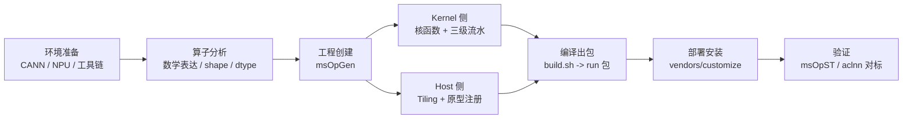

# Ascend C 单算子开发流程与验证

当模型在昇腾 NPU 上遇到"某个算子不支持"或"某个算子太慢"时，最终的解决路径通常落在 Ascend C 自定义算子上。Ascend C 是 CANN 面向算子开发的原生 C/C++ 编程语言，也是理解 NPU 执行模型的最好入口。

本篇回答：

> 在昇腾 NPU 上开发一个 Ascend C 自定义算子，从算子分析到编译部署、精度验证，官方推荐的完整流程是什么？每一步的关键概念和产物是什么？

本篇是官方入门流程的精简版，不复制官方示例代码。目标是让读者建立完整流程的地图，再按需深入官方文档。

## 一张总图：单算子开发全流程

官方快速入门（以 Add 算子为例）给出的链路是：



这条链路可以概括成三个问题：

1. **算子做什么**：算子分析，明确数学语义和输入输出规格。
2. **算子怎么实现**：kernel 侧写计算，host 侧写切分和注册。
3. **算子对不对、快不快**：与标杆实现做精度比对，必要时用 profiler 看性能。

## 背景：为什么是这套流程

Ascend C 的设计动机决定了这套流程的形态：

| 设计目标 | 对流程的影响 |
| --- | --- |
| 原生 C/C++ 规范 | 开发者用标准 C++ 写 kernel，不学新语法（除少量限定符） |
| 自动并行调度 | SPMD 模型，host 一次启动多核，kernel 内用核 ID 区分数据 |
| CPU/NPU 孪生调试 | 同一份代码可以在 CPU 侧模拟执行，先验证逻辑再上 NPU |
| Local Memory 容量有限 | 必须有 Tiling 机制，把大 tensor 切成片上放得下的小块 |

前三点降低了入门门槛，第四点引入了 GPU kernel 开发中没有显式暴露的独立环节：host 侧 tiling。

## 基本概念

阅读后续流程前，先建立这些概念。它们在 [NPU 架构基础](../12-hardware-basics/npu-basics.md) 中有更架构化的解释。

| 概念 | 含义 | 为什么重要 |
| --- | --- | --- |
| 核函数 | 用 `extern "C" __global__ __aicore__` 修饰的设备函数 | kernel 侧的入口，host 侧通过 `<<<blockDim, l2ctrl, stream>>>` 语法启动 |
| SPMD | 多核共享同一份指令代码 | 每个核用 `GetBlockIdx()` 区分身份，决定自己处理哪段数据 |
| blockDim | 启动的核实例数 | host 侧设置，一般等于物理核数，决定并行度 |
| GlobalTensor | 指向 Global Memory（HBM）数据的tensor | 输入、权重和输出都在这里，大但远 |
| LocalTensor | 指向片上存储（UB/L1/L0）的 tensor | 计算发生在这里，小但快 |
| DataCopy | 数据搬运接口 | GM 与 Local 之间搬数据，对应 MTE/DMA 能力 |
| TPipe / TQue / TBuf | 流水管理对象 | TPipe 分配 buffer，TQue 用队列做生产者-消费者同步 |
| Tiling | 把大 tensor 切成小块的切分方案 | 决定每次搬运块大小和循环次数 |

一个关键区别：CUDA 里 tiling 信息通常写在 kernel 内部或由编译器处理；Ascend C 把它独立成 host 侧的一个函数，在算子下发前执行。原因是 tiling 全是标量计算，AI Core 不擅长，交给 host CPU 更合理。

## 第一步：算子分析

写任何代码前，官方要求先明确四件事：

1. **数学表达式**：算子做什么计算，例如 `z = x + y`。
2. **输入输出规格**：每个 tensor 的 shape、dtype、format，以及是否支持动态 shape。
3. **核函数定义**：函数名、参数列表（哪些是输入、输出、属性）。
4. **所需接口清单**：要用哪些 Ascend C 接口，例如 `DataCopy`、计算 API（如 `Add`）、`AllocTensor`、`EnQue` 等。

这一步的产物是一张"算子规格表"。后面 kernel 侧、host 侧、验证用例都从这张表推导。

## 第二步：工程创建

官方提供两种入门路径：

| 路径 | 适用场景 | 特点 |
| --- | --- | --- |
| Kernel 直调（Kernel Launch） | 快速验证 kernel 逻辑 | 用 `<<<>>>` 直接调核函数；CPU 侧用 `ICPU_RUN_KF` 宏孪生调试；不涉及框架注册 |
| 自定义算子工程（msOpGen） | 正式交付的算子 | 生成标准工程结构，走完编译、部署、注册、验证全流程 |

正式开发用 `msOpGen` 创建工程。生成的标准结构和职责分工：

```text
add_custom/
├── op_host/
│   ├── add_custom_tiling.h    # TilingData 结构定义
│   └── add_custom.cpp         # 算子原型注册、shape 推导、tiling 实现
├── op_kernel/
│   └── add_custom.cpp         # 核函数实现（三级流水）
├── framework/                 # AI 框架插件适配目录
├── CMakePresets.json          # 编译配置（芯片型号、CANN 路径）
├── build.sh                   # 编译入口
├── cmake/ scripts/            # 编译与打包脚本
```

开发者主要修改 `op_host/` 和 `op_kernel/` 下的文件。

## 第三步：Kernel 侧实现

Ascend C 核函数的标准范式是"三级流水"：

```text
CopyIn：GM -> Local（搬入）
Compute：在 Local 上计算（算）
CopyOut：Local -> GM（搬出）
```

三段任务通过队列（TQue）通信同步，流水线重叠后，搬入下一块数据时上一块正在计算。用一个极简的伪代码结构表达（不是可运行代码）：

```text
kernel(add) {
  pipe.InitBuffer(inQue, outQue, ...)      # 分配队列和 buffer
  for 每个 tile:
    xLocal = inQueX.AllocTensor()          # 申请输入空间
    DataCopy(xLocal, xGm, tileLen)         # 搬入
    inQueX.EnQue(xLocal)                   # 入队
    ...
    yLocal = inQueX.DeQue()                # 计算任务取数据
    Add(zLocal, xLocal, yLocal, tileLen)   # 计算
    outQue.EnQue(zLocal)
    ...
    zLocal = outQue.DeQue()                # 搬出任务取数据
    DataCopy(zGm, zLocal, tileLen)         # 搬出
    FreeTensor / 释放
}
```

进阶方向是 Matmul 高阶 API：它封装了矩阵乘的 tiling、搬运和计算的通用逻辑，配套 `REGIST_MATMUL_OBJ`、`SetTensorA/B`、`IterateAll` 等接口和预置的 `TCubeTiling`。写融合算子（如 MatMul + LeakyReLU）时从它开始，而不是手写全部搬运逻辑。

## 第四步：Host 侧 Tiling 与注册

`op_host/` 下要完成两件事。

### Tiling 实现

tiling 函数从 `TilingContext*` 上下文读取算子的输入、输出和属性，计算并写回四类结果：

| 产物 | 含义 | 要点 |
| --- | --- | --- |
| TilingData | 切分参数结构体 | 每次搬运块多大、循环多少次；host/kernel 两侧共用同一结构定义 |
| BlockDim | 核函数启动的核数 | 逻辑核数范围 [1, 65535]，一般设为物理核数 |
| TilingKey | kernel 实现分支的标识 | 类似 C++ 模板机制：一个算子可有多个 kernel 实现，host 侧按条件选一个下发 |
| WorkspaceSize | 中间工作空间大小 | kernel 需要的 GM 临时空间 |

kernel 侧用 `GET_TILING_DATA` 宏解码这些数据。TilingData 的定义支持宏定义（`BEGIN_TILING_DATA_DEF`）和标准 C++ 类两种方式，后者用 `REGISTER_TILING_DEFAULT` / `REGISTER_TILING_FOR_TILINGKEY` 注册。

### 原型注册

`op_host/*.cpp` 中同时完成算子原型注册（算子名、输入输出规格、shape 推导函数、信息库），让框架和 CANN 认识这个算子。

## 第五步：编译与部署

流程很短，但有两个易错点：

1. 修改 `CMakePresets.json`：设置 `ASCEND_COMPUTE_UNIT`（芯片型号，用 `npu-smi info` 查询）和 `ASCEND_CANN_PACKAGE_PATH`（CANN 安装路径）。
2. 执行 `./build.sh`，在 `build_out/` 下生成自定义算子 run 包，形如 `CANN-custom_ops-<version>-linux.<arch>.run`。

部署时先 source CANN 环境，再安装 run 包。默认安装到 `opp/vendors/customize/`，按安装提示更新 `LD_LIBRARY_PATH`（包含 `op_api/lib`）。

## 第六步：验证

官方提供两类互补的验证方法。

### 方法一：msOpST 算子测试

编写用例定义 json（case 名、算子名、输入的 format/type/shape/data 分布/取值范围，正交组合生成用例），执行：

```text
msopst run -i case.json -soc <soc_version> -out <目录>
```

在真实硬件上运行，输出 `st_report.json`。可以提供 `calc_expect_func` 标杆函数（例如一个 Python 参考实现），msOpST 会自动做输出与标杆的精度比对。

### 方法二：aclnn 单算子调用验证

CANN 开源算子仓 cann-ops 中每个算子自带 `examples/`，其中 AclNNInvocationNaive 示例的"三步法"是社区事实标准：

```text
1. gen_data.py       # 按 shape/范围生成输入，计算标杆结果，存 .bin
2. main.cpp (编译执行) # 调 aclnn 接口在 NPU 上执行，保存实际输出
3. verify_result.py  # 比对标杆与实际输出
```

无论自定义算子还是内置算子，通常都通过 `aclnn` 前缀的单算子 API 调用，这是最简单灵活的直调方式。通常配套 `run.sh` 一键执行三步。

### 精度判定口径

比对脚本采用 numpy 风格容差：`|a - b| <= atol + rtol * |b|`。容差取值取决于 dtype 和算子语义，建议参考同类官方算子示例的取值。社区实践中还常用误差分布统计（如千分位误差）辅助判断，属于补充口径而不是官方要求。

### 与 PyTorch 集成验证

要让算子在 PyTorch/torch_npu 里可用，有两条官方路径：

| 路径 | 做法 | 适用 |
| --- | --- | --- |
| Kernel Launch 直调 | `TORCH_LIBRARY` 注册算子，`TORCH_LIBRARY_IMPL` 绑定到 NPU 的 `PrivateUse1` DispatchKey，实现函数内取 `c10_npu::getCurrentNPUStream()` 后 `<<<>>>` 直调；Python 侧 `torch.ops.load_library` 加载 | 快速实验、不走完整算子工程 |
| aclnn + 框架适配插件 | 算子走完整工程出包，再开发 OpPlugin 适配，以 aclnn API 形式被框架调用 | 正式交付 |

MindSpore 侧对应做法是 `ops.Custom`（func_type="aot"），单算子执行模式同样推荐 aclnn 调用。

## 性能验证思路

精度通过后，性能验证回到本知识库的通用方法：

- 用 msprof 或 `torch_npu.profiler` 采集算子耗时，方法见 [昇腾 Profiling](../08-benchmark-capacity/ascend-profiling-msprof.md)。
- 和标杆实现（官方内置算子、CPU 参考或竞品实现）在相同 shape/dtype 下对比。
- 关注算子是 compute-bound 还是 memory-bound，判断 tiling 是否合理（块太小导致搬运次数多，块太大导致片上放不下）。

## 适用范围

适用于：

- 框架不支持的算子需要自己实现。
- 已有算子性能不满足要求，需要手工优化。
- 想深入理解 NPU 执行模型（tiling、片上存储、流水线）。
- 学习昇腾生态的算子开发工程化流程（注册、出包、部署、验证）。

需要谨慎：

- 简单的元素级操作优先考虑组合已有算子或用 torch.compile 生成，自定义算子维护成本高。
- 性能问题先 profiling 确认瓶颈确实在算子本身，再决定重写。
- CANN 版本迭代较快（文档已从 7.x 演进到 9.x），具体 API 和工程配置以所用版本的官方文档为准。

## 常见误区

### 误区一：把 tiling 写进 kernel

tiling 是标量计算，放在 kernel 里浪费 AI Core，且切分参数需要 host 侧在算子下发前决定。正确姿势是 host 侧 tiling 函数算好，通过 TilingData 传给 kernel。

### 误区二：跳过 CPU 孪生调试直接上 NPU

Ascend C 支持 CPU/NPU 孪生调试。先用 `ICPU_RUN_KF` 在 CPU 侧验证逻辑正确性，再上 NPU 调性能，排错成本低得多。

### 误区三：验证只看"能跑通"

算子验证必须包含与标杆的精度比对（rtol/atol），且要在多个 shape（含动态 shape 边界）下验证。只跑通一个 shape 就交付，动态 shape 场景会出问题。

### 误区四：硬编码芯片参数

核数、UB/L1/L0 大小不要写死。不同 SKU、vNPU 切分会让可见资源变化，应通过平台接口（如 `PlatformAscendC`）查询，详见 [Ascend 910 系列平台要点](../12-hardware-basics/ascend-910-series.md)。

## 与相关技术的关系

| 相关技术 | 关系 |
| --- | --- |
| [NPU 架构基础](../12-hardware-basics/npu-basics.md) | 上游概念：存储层级、执行模型、编程模型的架构解释 |
| [Ascend/CANN 软件栈与开发入口](../12-hardware-basics/cann-stack.md) | Ascend C 在 CANN 软件栈中的位置 |
| [Triton Kernel 编程](triton.md) | 同层对比：Triton 在 GPU（及 Triton-Ascend 路径）上的编程模型 |
| [TileLang](tilelang.md) | 同层对比：tile-oriented DSL 的另一种表达 |
| [昇腾 Profiling](../08-benchmark-capacity/ascend-profiling-msprof.md) | 下游：算子性能验证的工具方法 |

## 小结

- Ascend C 单算子开发的官方主线是：**算子分析 → msOpGen 建工程 → kernel 侧三级流水 + host 侧 tiling/注册 → build.sh 出包部署 → msOpST/aclnn 对标验证**。
- 与 GPU kernel 开发最大的结构差异是 **host 侧 tiling 独立成环节**：Local Memory 容量有限决定了必须先切分再下发。
- 验证的社区事实标准是 **aclnn 三步法**：生成数据与标杆 → NPU 执行 → 精度比对（rtol/atol）。
- 入门样例建议按官方路径：Add（快速入门双路径）→ LeakyRelu（矢量 API）→ MatMul + LeakyReLU 融合（Matmul 高阶 API）。

## 参考资料

- [Ascend C 自定义算子开发（基于自定义算子工程的开发全流程）](https://www.hiascend.com/document/detail/zh/canncommercial/800/developmentguide/opdevg/Ascendcopdevg/atlas_ascendc_10_0006.html)：官方快速入门主文档。
- [算子分析（AddCustom 示例）](https://www.hiascend.com/document/detail/en/canncommercial/800/opdevg/Ascendcopdevg/atlas_ascendc_10_0005.html)：kernel 直调路径与算子分析方法。
- [Tiling 实现（host 侧）](https://www.hiascend.com/document/detail/en/canncommercial/850/opdevg/Ascendcopdevg/atlas_ascendc_10_0031.html)：tiling 的动机、输入输出与实现。
- [Matmul 高阶 API（MatMul+LeakyReLU 示例）](https://www.hiascend.com/document/detail/en/canncommercial/850/opdevg/Ascendcopdevg/atlas_ascendc_10_0050.html)
- [PyTorch 两条适配路径](https://www.hiascend.com/document/detail/en/canncommercial/850/opdevg/Ascendcopdevg/atlas_ascendc_10_0057.html)：Kernel Launch 与 aclnn/OpPlugin。
- [cann-ops 开源算子仓 QuickStart](https://gitee.com/ascend/cann-ops/blob/master/QuickStart.md)：工程结构、build.sh、aclnn 三步法验证。
- [msOpST 快速开始](https://github.com/Ascend/msopgen/blob/26.0.0/docs/en/quick_start/msopst_quick_start.md)：算子 ST 测试方法。
- [Ascend C 官网学习地图](https://www.hiascend.com/cann/ascend-c)：快速上手、进阶开发、深度驾驭课程。
- [我的第一份 Ascend C 代码](https://www.cnblogs.com/huaweiyun/p/17669701.html)：华为云官方博客，流程与三级流水图解。
