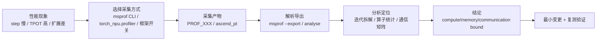

# 昇腾 Profiling：msprof 与 CANN 性能数据采集分析

本篇是 [Profiler 工具链与瓶颈定位](profiler-toolchain-bottleneck-analysis.md)（GPU 视角：Nsight、PyTorch Profiler、DCGM、perf、eBPF）的昇腾姊妹篇。

本篇回答：

> 在昇腾 NPU 上，应该用哪些工具采集性能数据（msprof、torch_npu.profiler、MindStudio Insight），采到的数据文件里有什么，以及如何用它们回答"慢在哪、为什么慢"？

和 GPU 侧一样，核心原则不变：

```text
先定义要证明什么，再决定采什么。
```

## 一张总图：从问题到结论



## 工具全景

| 工具 | 定位 | 适用场景 |
| --- | --- | --- |
| msprof CLI | CANN Toolkit 自带的采集/解析命令行工具，可拉起任意脚本 | 通用入口，训练/推理脚本均可；算子级采集 |
| torch_npu.profiler | Python API，与 `torch.profiler` 用法对齐，底层复用 CANN Profiling | PyTorch/torch_npu 代码，希望按 step 调度采集 |
| MindStudio Insight | GUI 可视化分析 | 时间线观察、通信矩阵、概览页等交互式分析 |
| msprof-analyze | 命令行深度分析 | 通信瓶颈定位、集群耗时拆解（多卡） |
| 框架封装 | MindSpeed-LLM `--profile` 系列、vllm-ascend `/start_profile` 接口 | 用对应框架训练/推理时最省事 |

选择建议：写 PyTorch 代码用 torch_npu.profiler；跑任意脚本或做算子级采集用 msprof；拿到数据后用 MindStudio Insight 看时间线；多卡通信问题再上 msprof-analyze。

## 采集方法

### msprof CLI

基本用法是让 msprof 拉起目标脚本：

```bash
msprof --output=./prof_data --task-time=l1 python3 train.py
```

常用开关：

| 开关 | 作用 |
| --- | --- |
| `--task-time=l0/l1` | 采集级别；**l1 才有 AI Core PMU 指标**（指令占比、利用率） |
| `--aicpu` | AI CPU 数据开关 |
| `--aic-metrics` | AI Core 指标类型，如 `PipeUtilization` |
| `--sys-hardware-mem` | DDR/LLC 带宽 |
| `--sys-profiling` | CPU/内存利用率 |
| `--runtime-api` `--model-execution` | Runtime API、模型执行信息 |

离线解析已采集的目录：

```bash
msprof --export=on --output=PROF_XXXX/          # 导出文本/db
msprof --analyze=on --rule=communication_matrix --output=PROF_XXXX/  # 解析通信数据
```

**算子级采集**（对标 GPU 上的 micro-benchmark）：用 `msprof op` 以"预热 + 多次执行"的方式循环采集单个算子：

```bash
msprof op --output=./op_data --kernel-name=<算子名> \
  --warm-up=20 --launch-count=20 python3 test_op.py
```

结果中的 `Task Duration(us)` 是算子耗时，适合自定义算子与标杆算子的对比（见 [Ascend C 单算子开发流程与验证](../05-kernels-compilers/ascendc-operator-development.md)）。

### torch_npu.profiler

用法与 `torch.profiler` 对齐，典型模式是 schedule 控制采集窗口：

```python
import torch, torch_npu

with torch_npu.profiler.profile(
    activities=[torch_npu.profiler.ProfilerActivity.CPU,
                torch_npu.profiler.ProfilerActivity.NPU],
    schedule=torch_npu.profiler.schedule(
        wait=1, warmup=1, active=2, repeat=1, skip_first=1),
    on_trace_ready=torch_npu.profiler.tensorboard_trace_handler("./result"),
) as prof:
    for step in range(steps):
        train_one_step()
        prof.step()   # 驱动 schedule 状态机
```

昇腾特有的扩展通过 `_ExperimentalConfig` 传入：

| 配置 | 作用 |
| --- | --- |
| `profiler_level` | 采集级别 Level0/1/2，级别越高信息越多、开销越大 |
| `aic_metrics` | AI Core 指标：`PipeUtilization`、`ArithmeticUtilization`、`Memory`、`L2Cache` 等 |
| `export_type` | 导出 Text/Db |
| `record_op_args` | 记录算子参数（方便对齐到代码，开销大） |
| `msprof_tx` / mstx | 自定义打点标注，相当于 GPU 侧 NVTX |

离线解析：`analyse(path, export_type=["db"])`，或直接把落盘目录交给 MindStudio Insight。

### 框架封装

- MindSpeed-LLM：`--profile --profile-step-start 5 --profile-step-end 10` 类参数，自动按 step 采集。
- vllm-ascend：服务运行中调 `/start_profile`、`/stop_profile` 接口在线采集，无需重启服务。

## 采集产物长什么样

torch_npu.profiler 产出 `{host}_{pid}_{time}_ascend_pt/` 目录，内含两部分：`ASCEND_PROFILER_OUTPUT/`（分析结果）和 `PROF_XXX/`（CANN 层原始数据）。msprof 直采则直接得到 `PROF_XXX/`。

关键文件（`ASCEND_PROFILER_OUTPUT` 或 `mindstudio_profiler_output` 下）：

| 文件 | 内容 | 回答什么问题 |
| --- | --- | --- |
| `trace_view.json` | Chrome Trace 时间线（MindStudio Insight / perfetto / `chrome://tracing` 可打开） | 全局时间线：谁在什么时候执行 |
| `kernel_details.csv` | 每个 NPU 算子明细：Task/Stream ID、Duration、Wait Time、Accelerator Core（AI Core/AI CPU）、输入输出 shape | 单个算子为什么慢 |
| `op_statistic.csv` | 按算子类型聚合的调用次数与总耗时 | 哪类算子吃掉了时间 |
| `operator_details.csv` | Host/Device 侧 Self/Total Duration | host 开销 vs device 执行 |
| `step_trace_time.csv` | 迭代级拆解（计算/通信/空闲等） | 一个 step 的时间去哪了 |
| `communication.json` / `communication_matrix.json` | 通信矩阵：带宽、传输大小、链路（Level1+、多卡） | 通信是否是瓶颈 |
| `memory_record.csv` 等 | 内存记录（需 `profile_memory=True`） | 显存申请与释放 |

`op_summary` 类文件的关键字段：

| 字段 | 含义 |
| --- | --- |
| `Task Duration(us)` | 算子任务耗时（含调度 + 执行 + 结束响应） |
| `Task Type` | AI_CORE / AI_VECTOR_CORE / AI_CPU / CCU / DPU |
| `Task Wait Time(us)` | 任务排队等待时间 |
| `*_mac_ratio` / `*_vec_ratio` | Cube / Vector 指令占比（需 `--aic-metrics=PipeUtilization`） |
| `*_mte1/2/3_ratio` | 搬运指令占比 |
| `cube_utilization` | Cube 利用率 |

## 分析方法：从现象到瓶颈

按下面的顺序看数据，可以覆盖大部分性能问题。

### 第一步：迭代拆解，看 step 时间去哪了

`step_trace_time.csv` 把每个迭代拆成：

| 分量 | 含义 | 判断 |
| --- | --- | --- |
| Computing | 计算时间 | 占比高 → 进入第二步看算子 |
| Communication(Not Overlapped) | 未被计算掩盖的通信时间 | 占比高 → 通信瓶颈 |
| Overlapped | 计算通信重叠部分 | **越多越好** |
| Free | 迭代总时间减计算和通信 | 大 → 数据加载、host 下发慢、空泡 |
| Bubble | 流水并行空泡（receive 算子时间之和） | PP 场景大 → 流线安排问题 |

训练场景先看这张表，再决定往算子细节还是通信方向深挖。

### 第二步：算子统计，找热点和 bound 类型

在 `op_statistic.csv` 按总耗时排序，得到 top 算子；再到 `kernel_details.csv` / `op_summary` 看这些算子的执行细节。

判断单个算子是 compute-bound 还是 memory-bound，官方给出一个直接可算的指标：

```text
memory_bound = mte2_ratio / max(mac_ratio, vec_ratio)
```

- 大于 1：大部分时间在搬数而不是计算，越大 memory-bound 越严重。
- `cube_utilization` 接近 100%：计算已接近理论上限，优化方向只能减少计算量或换精度。

这一步相当于 GPU 侧 Nsight Compute 的occupancy/memory throughput 分析，但可以用 CSV 直接算。

同时注意 `Task Type` 分布：如果高耗时算子大量落在 **AI CPU** 而不是 AI Core，说明很多算子没有真正下放到 NPU 计算单元执行，需要从算子支持或调度层面解决。

### 第三步：时间线，看空泡和下发瓶颈

用 MindStudio Insight 打开 `trace_view.json` 或 PROF 目录。时间线泳道从上到下分三层：

```text
Python 层       API 调用
CANN 层         AscendCL / GE / Runtime
Ascend Hardware Stream 任务流 + Step Trace 迭代轨迹
```

重点观察**算子之间的间隙**：device 侧有空隙，通常是 host 下发不及时（launch 瓶颈）、同步等待或数据未就绪；这对应 GPU 侧用 Nsight Systems 找 CPU launch gap 的方法。

多卡场景看概览（Summary）页，它按 TP/PP/DP/CP 通信域拆解计算、通信、空闲时间；通信页给出通信矩阵，可以看带宽是否达到链路上限。

### 第四步：多卡通信，定位慢卡

多卡训练扩展差时，用 msprof-analyze 的 communication bottleneck 分析：

```bash
msprof-analyze communication_bottleneck -d=PROF_XXXX/
```

它用 **Wait Time Ratio**（阈值 0.2）判定慢卡，并区分 Host Bound（通信任务下发慢）和 Device Bound（通信执行慢），直接给出"哪张卡拖后腿、卡在 host 还是 device"。

### GPU 工具对照

从 GPU 迁移过来的读者可以按这张表对号入座：

| GPU 侧 | 昇腾侧 | 说明 |
| --- | --- | --- |
| Nsight Systems（整机时间线） | msprof 采集 + MindStudio Insight Timeline | 找空泡、下发间隙、同步等待 |
| Nsight Compute（单 kernel 指标） | op_summary 的 PMU 指标（l1 级别）/ `msprof op` | occupancy、指令占比、利用率 |
| PyTorch Profiler | torch_npu.profiler | 同一套 API 语义 |
| NVTX 自定义标注 | msprof_tx / mstx | 标记代码区间 |
| DCGM（设备监控） | npu-smi / msprof `--sys-profiling` | 利用率、功耗、带宽、健康状态 |
| NCCL 日志分析 | communication 矩阵 + msprof-analyze | 通信带宽、慢卡定位 |

## 采集注意事项

| 事项 | 说明 |
| --- | --- |
| 采集开销 | `with_stack`、`with_memory`、`record_shapes` 会显著膨胀数据、劣化性能；确认瓶颈分析不需要时关闭 |
| 跳过冷启动 | 用 schedule 的 `wait`/`skip_first` 或框架参数（如 MindSpeed `--profile-step-start 5`）跳过前几步，避免初始化污染 |
| warmup 步的污染 | warmup 窗口内异步算子完成时间可能被计入下一个 step，解读 step 归属时要小心 |
| 多次取平均 | 正式结论基于 Task Duration 的多次采集均值，不要用单次 wall-clock 计时 |
| 数据规模 | Timeline 默认最多展示约 3 分钟数据；`data_simplification=True` 可只保留原始数据省空间 |
| 多卡分析 | 建议 export 为 db 格式，供 msprof-analyze 做集群级分析 |

## 适用范围

适用于：

- 昇腾 NPU 上的训练 step 时间拆解与 MFU 分析。
- 推理服务（含 vllm-ascend）的 TTFT/TPOT 瓶颈定位。
- 自定义算子的性能验证与对标。
- 多卡/多机扩展效率问题、慢卡定位。

需要谨慎：

- 采集本身有开销，profiling 期间的性能数字不能直接当作线上性能。
- 结论要和 benchmark 复测闭环：profiler 给出"慢在哪"，改完后用同一 workload 复测验证。
- CANN 版本间字段和开关名可能变化，以所用版本的官方文档为准。

## 常见误区

### 误区一：只看 NPU 利用率

和 GPU utilization 一样，NPU 利用率高不代表没瓶颈：可能大量算子跑在 AI CPU 上，或 Cube 利用率低但整体"忙碌"。要看 `Task Type` 分布和 PMU 指标。

### 误区二：拿 wall-clock 时间做算子结论

单次脚本前后计时包含了 host 开销和缓存效应。算子耗时应以 op_summary 的 Task Duration、多次采集均值为准，算子级用 `msprof op` 的 warm-up + 多次执行模式。

### 误区三：一上来就开全部采集项

Level2 + with_stack + memory + record_op_args 全开，数据膨胀到难以分析，性能劣化也改变了被测系统。按假设选最小采集集，不够再加。

## 与相关技术的关系

| 相关主题 | 关系 |
| --- | --- |
| [Profiler 工具链与瓶颈定位](profiler-toolchain-bottleneck-analysis.md) | GPU 视角的姊妹篇，方法论（证据链、Profiling Contract）通用 |
| [Ascend C 单算子开发流程与验证](../05-kernels-compilers/ascendc-operator-development.md) | 下游：自定义算子的性能验证用 `msprof op` |
| [NPU 架构基础](../12-hardware-basics/npu-basics.md) | AI Core/AI CPU、Cube/Vector、存储层级等概念基础 |
| [训练性能剖析与 Benchmark](../04-training-systems/training-benchmark-profiling.md) | 训练侧的通用 profiling 方法 |
| [通信与计算重叠](../04-training-systems/communication-computation-overlap.md) | Overlapped/Not Overlapped 分量的优化方向 |

## 小结

- 昇腾 profiling 的三个入口：**msprof CLI**（任意脚本、算子级）、**torch_npu.profiler**（PyTorch 代码、按 step）、**框架封装**（MindSpeed/vllm-ascend 开关），数据统一落到 `PROF_XXX` / `ascend_pt` 目录。
- 分析顺序：**step_trace_time 迭代拆解 → op_statistic 算子热点 + memory_bound/cube_utilization 判断 bound 类型 → 时间线看空泡和下发 → 多卡用 msprof-analyze 定位慢卡**。
- 最重要的两个可算指标：`memory_bound = mte2_ratio / max(mac_ratio, vec_ratio)` 判断访存瓶颈，`cube_utilization` 判断计算上限。
- 采集纪律和 GPU 侧一致：先定假设、跳过冷启动、最小采集集、多次取平均、结论用 benchmark 复测闭环。

## 参考资料

- [msprof 快速入门（官方文档仓）](https://gitcode.com/Ascend/msprof/blob/master/docs/zh/quick_start/msprof_quick_start.md)：CLI 用法与开关。
- [msprof 数据文件参考](https://gitcode.com/Ascend/msprof/blob/master/docs/zh/user_guide/profile_data_file_references.md)：op_summary 字段、memory_bound 判据。
- [msprof 解析指令](https://gitcode.com/Ascend/msprof/blob/master/docs/zh/user_guide/msprof_parsing_instruct.md)：export / analyze 用法。
- [Ascend PyTorch Profiler 用户指南](https://gitcode.com/Ascend/pytorch/blob/master/docs/zh/developer_notes/ascend_pytorch_profiler_user_guide.md)：torch_npu.profiler 用法与产物。
- [MindStudio Insight 系统调优指南](https://gitcode.com/Ascend/msinsight/blob/master/docs/zh/user_guide/system_tuning.md)：时间线、概览、通信分析。
- [msprof-analyze 通信瓶颈分析](https://gitcode.com/Ascend/msprof-analyze/blob/master/docs/zh/advanced_features/communication_bottleneck_instruct.md)：慢卡定位方法。
- [MindSpeed-LLM profiling 工具](https://gitcode.com/Ascend/MindSpeed-LLM/blob/master/docs/zh/pytorch/tools/profiling.md)：训练框架封装。
- [vllm-ascend 服务级 profiling 指南](https://github.com/vllm-project/vllm-ascend/blob/main/docs/source/developer_guide/performance_and_debug/service_profiling_guide.md)：推理服务在线采集。
